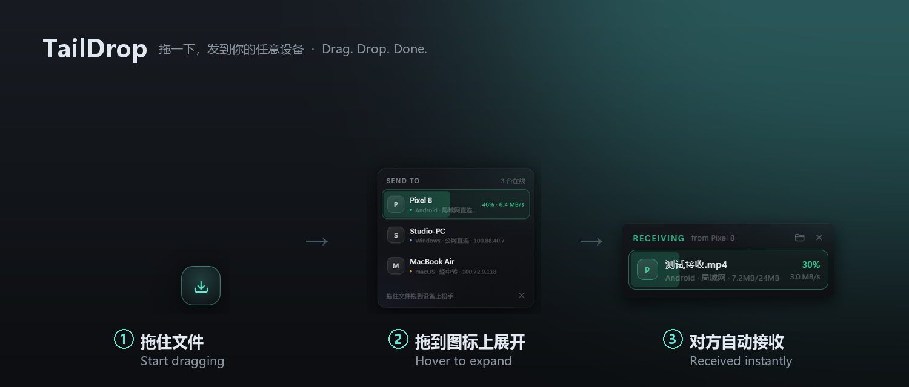
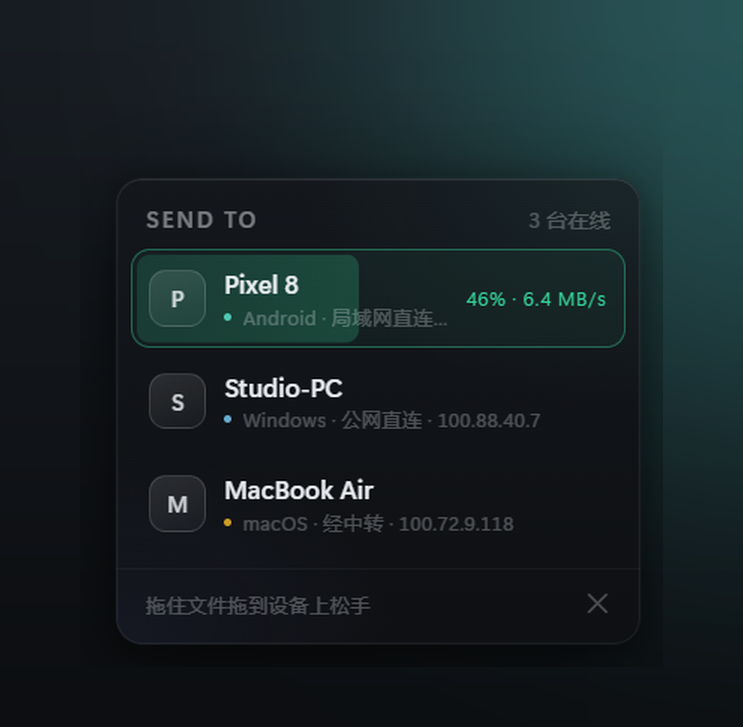
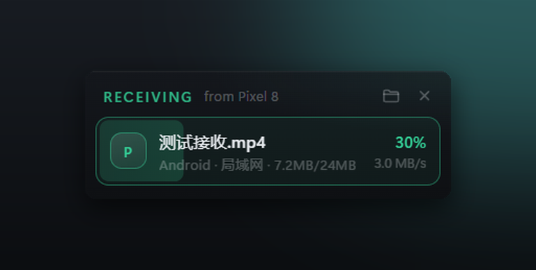

# TailDrop

[中文](README.md) | **English**

Drag a file on Windows and send it to any device on your Tailscale network. The receiver doesn't have to accept anything: the file lands straight in their downloads folder.



> TailDrop is a small desktop tool built on top of [Tailscale](https://tailscale.com)'s built-in Taildrop feature. It is not affiliated with Tailscale.

## Features

- **Drop onto the icon to send**: start dragging any file and a small icon pops up in the bottom-right corner. Drag onto it and it expands into a list of online devices. Release over a device to send.
- **Online devices only**: offline devices are hidden, and the list grows or shrinks with the number of devices.
- **Connection status**: each device shows "LAN direct", "Internet direct" or "Relayed". On the same Wi-Fi, Tailscale picks the local network automatically, with no extra setup.
- **Send progress**: the device row fills with an emerald progress bar, with percentage and speed on the right.
- **Incoming transfers**: when someone sends a file to this PC, a receive bar appears in the bottom-right corner with progress and speed. It stays for 10 seconds after finishing and has a button to open the downloads folder.
- **Lives in the tray**: the right-click menu has a "Start with Windows" toggle.

| Send panel | Receive bar |
|---|---|
|  |  |

> The UI text is currently in Chinese only.

## Install

Requirements:

1. 64-bit Windows 10 / 11
2. [Tailscale](https://tailscale.com/download) installed and signed in. Any install location works; TailDrop finds it
3. Both ends signed in to the **same Tailscale account** (Taildrop only works between your own devices)
4. [Node.js](https://nodejs.org) 18 or newer (only needed to install dependencies)

```bash
git clone https://github.com/Zonex313/TailDrop.git
cd TailDrop
npm install
```

Then double-click `启动 TailDrop.bat` ("Start TailDrop") or run `npm start`. TailDrop stays in the system tray.

Once dependencies are installed, you can copy the whole folder (including `node_modules`) to another PC and run it there.

## On your phone

Just install the official Tailscale app. Nothing else is needed:

- **Receiving on the phone**: in Tailscale, go to Settings → Permissions, allow storage and notifications, and pick a Taildrop folder.
- **Sending from the phone**: in your gallery or file manager, tap Share → Tailscale and pick this PC.

## Details

- If you drag a file but never touch the icon, the icon disappears when you let go. If you drag into the list and back out, it shrinks back to the icon first, then disappears when you let go.
- Left-clicking the tray icon opens the full list directly.
- Click outside the panel, press Esc or click ✕ to close it.
- When the sender is another PC running TailDrop, the receive bar shows the file name, percentage and speed.
- When the sender is a phone, Tailscale doesn't report the file name or total size mid-transfer, so the bar shows "receiving…", bytes received and speed. Each file switches to its real name once it finishes.
- On Windows, received files go to the system Downloads folder. Tailscale decides this; it can't be changed.

## How it works

- Sending calls `tailscale file cp`; progress comes from messages pushed by `tailscale debug watch-ipn`.
- Drag detection polls for Windows' `SysDragImage` window every 50 ms.
- The panel window is transparent. `setShape` makes only the icon or card clickable, so the rest of the area doesn't block the desktop.
- PCs running TailDrop also push progress to each other: TailDrop listens on port 47913 of the local Tailscale address and only accepts requests from Tailscale addresses (100.64.0.0/10).
- For files sent from a phone, receive progress is estimated from the Tailscale background process's cumulative disk-write bytes. No admin rights needed.

<details>
<summary>Code layout</summary>

| File | Purpose |
|---|---|
| `app/main.js` | Main process: tray, drag watching, panel and receive windows |
| `app/bus.js` | Keeps one `tailscale debug watch-ipn` running and fans out device and transfer updates |
| `app/devices.js` | Online device list and connection checks (pings on demand) |
| `app/sender.js` | Send queue, progress and speed |
| `app/receiver.js` | Receive detection: pushed progress / disk-write bytes / completion notices |
| `app/notify.js` | PC-to-PC progress push |
| `app/iometer.js` | Reads I/O counters of the Tailscale background process |
| `app/dragwatch.js` | System-wide "a file is being dragged" detection |
| `app/tailscale.js` | Locates the Tailscale install |
| `app/autostart.js` | Start with Windows (reads/writes `HKCU\...\Run`) |
| `app/mouse.js` / `app/dwm.js` | Mouse button state / turns off system window animations |
| `app/index.html` / `app/receive.html` | Send panel / receive bar UI |
| `app/devtest.js` | Dev only: set `TAILDROP_TEST_RECEIVE=1` to simulate a transfer |

Debugging: set `TAILDROP_DEBUG=1` to write a receive log to `%TEMP%\taildrop-receive.log`.

</details>

## Known limitations

- Windows only for now.
- Can only send to devices on the same Tailscale account.
- Relies on Tailscale's `debug watch-ipn` command (developed against 1.104). Very old Tailscale versions may not support it.

## License

[MIT](LICENSE)
