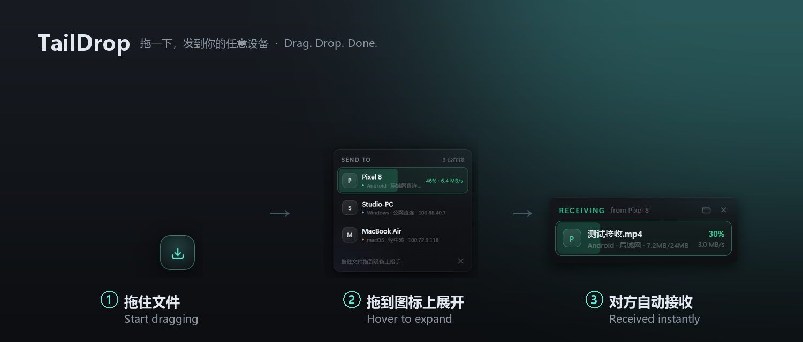
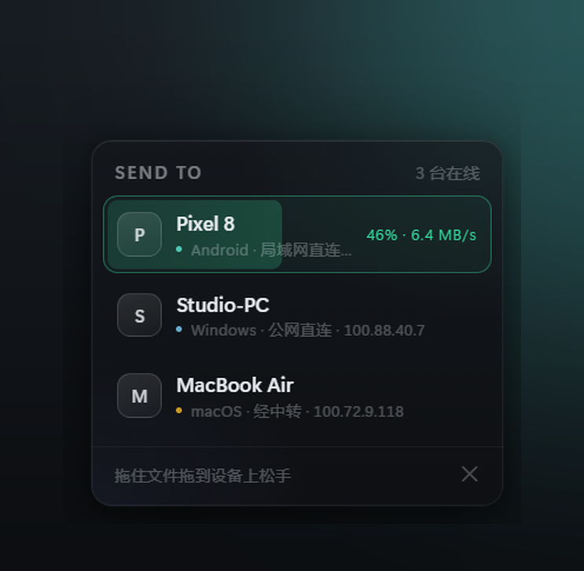
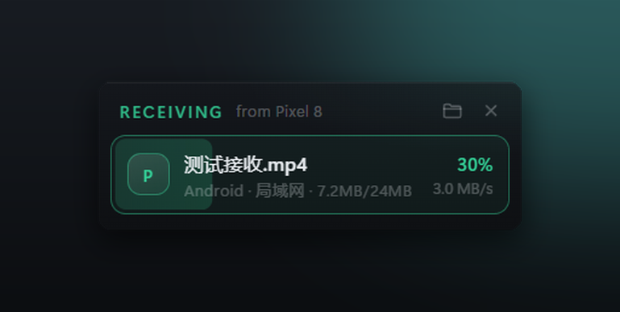

# TailDrop

**中文** | [English](README.en.md)

在 Windows 上拖一下，就把文件发到你 Tailscale 网络里的任意设备。接收端不用点"同意"，文件直接落进下载文件夹。



> 本项目是基于 [Tailscale](https://tailscale.com) 自带的 Taildrop 功能做的桌面小工具，与 Tailscale 官方无关。

## 功能

- **拖到图标上发送**：拖住任意文件，屏幕右下角立刻冒出一个小图标；拖到图标上，展开成在线设备列表；拖到某台设备上松手就发出去。
- **只列在线设备**：离线的不显示，列表高度随设备数量伸缩。
- **线路状态**：每台设备旁标出「局域网直连 / 公网直连 / 经中转」。同一 WiFi 下 Tailscale 会自动走局域网，不需要额外设置。
- **发送进度**：设备那一行有翠绿色进度条，右侧显示百分比和速度。
- **接收提醒**：别人往这台电脑发文件时，右下角自动弹出接收条，显示进度和速度；收完停 10 秒，可一键打开接收文件夹。
- **托盘常驻**：右键菜单可开关开机自启。

| 发送面板 | 接收提醒 |
|---|---|
|  |  |

## 安装

需要先准备：

1. 64 位 Windows 10 / 11
2. 已安装 [Tailscale](https://tailscale.com/download) 并登录。装在哪都行，程序会自己找
3. 收发两端登录**同一个 Tailscale 账号**（Taildrop 只能在自己的设备之间传）
4. [Node.js](https://nodejs.org) 18 或更高版本（只在安装依赖时用）

```bash
git clone https://github.com/Zonex313/TailDrop.git
cd TailDrop
npm install
```

然后双击 `启动 TailDrop.bat`，或运行 `npm start`。程序会常驻在托盘里。

装好依赖后，整个文件夹可以直接拷到别的电脑上用（包括 `node_modules`）。

## 手机端

手机装官方 Tailscale App 即可，不需要额外软件：

- **手机收文件**：先在 Tailscale「设置 → Permissions」里授权存储和通知，并选好 Taildrop 接收目录。
- **手机发文件**：在相册或文件管理器里点「分享 → Tailscale」，选这台电脑。

## 使用细节

- 拖住文件没去碰图标就松手，图标会自己消失；拖进列表又拖出来，会先缩回图标，松手再消失。
- 从托盘左键打开时，直接显示完整列表。
- 点面板外、按 Esc 或点 ✕ 可收起面板。
- 接收时，如果对方也是装了 TailDrop 的电脑，会显示文件名、百分比和速度。
- 如果对方是手机，Tailscale 传输中途不提供文件名和总大小，只能显示"正在接收文件…"、已收多少和速度；每个文件收完后换成真实文件名。
- Windows 上收到的文件在系统「下载」文件夹。这是 Tailscale 决定的，改不了。

## 原理

- 发送调用 `tailscale file cp`，进度来自 `tailscale debug watch-ipn` 推送的消息。
- "正在拖文件"靠轮询 Windows 的 `SysDragImage` 窗口来检测，每 50 毫秒一次。
- 面板窗口是透明的，用 `setShape` 只让图标或卡片那一块接收鼠标，其他区域不挡桌面。
- 电脑之间会额外互相推送进度：在本机 Tailscale 地址的 47913 端口监听，只接受 Tailscale 网内地址（100.64.0.0/10）的请求。
- 手机发来文件时，接收进度是读 Tailscale 后台进程的累计写盘字节数估算出来的，不需要管理员权限。

<details>
<summary>代码结构</summary>

| 文件 | 作用 |
|---|---|
| `app/main.js` | 主进程：托盘、拖拽监听、面板和接收条窗口 |
| `app/bus.js` | 常驻一个 `tailscale debug watch-ipn`，分发设备变化与传输进度 |
| `app/devices.js` | 在线设备列表与线路判断（按需 ping） |
| `app/sender.js` | 发送队列、进度与速度 |
| `app/receiver.js` | 接收检测：推送进度 / 写盘字节数 / 完成通知 |
| `app/notify.js` | 电脑之间推送进度 |
| `app/iometer.js` | 读 Tailscale 后台进程的 I/O 计数 |
| `app/dragwatch.js` | 全局检测"正在拖文件" |
| `app/tailscale.js` | 查找 Tailscale 安装位置 |
| `app/autostart.js` | 开机自启（读写 `HKCU\...\Run`） |
| `app/mouse.js` / `app/dwm.js` | 读鼠标按键 / 关掉系统窗口动画 |
| `app/index.html` / `app/receive.html` | 发送面板 / 接收条界面 |
| `app/devtest.js` | 开发用：设 `TAILDROP_TEST_RECEIVE=1` 模拟一次接收 |

调试：设 `TAILDROP_DEBUG=1` 会把接收日志写到 `%TEMP%\taildrop-receive.log`。

</details>

## 已知限制

- 目前只有 Windows 版。
- 只能发给同一 Tailscale 账号下的设备。
- 依赖 Tailscale 的 `debug watch-ipn` 命令（开发时用的是 1.104），太旧的 Tailscale 可能不支持。

## 许可

[MIT](LICENSE)
